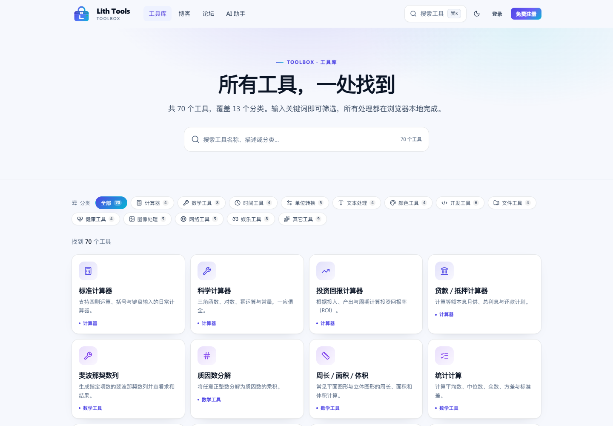
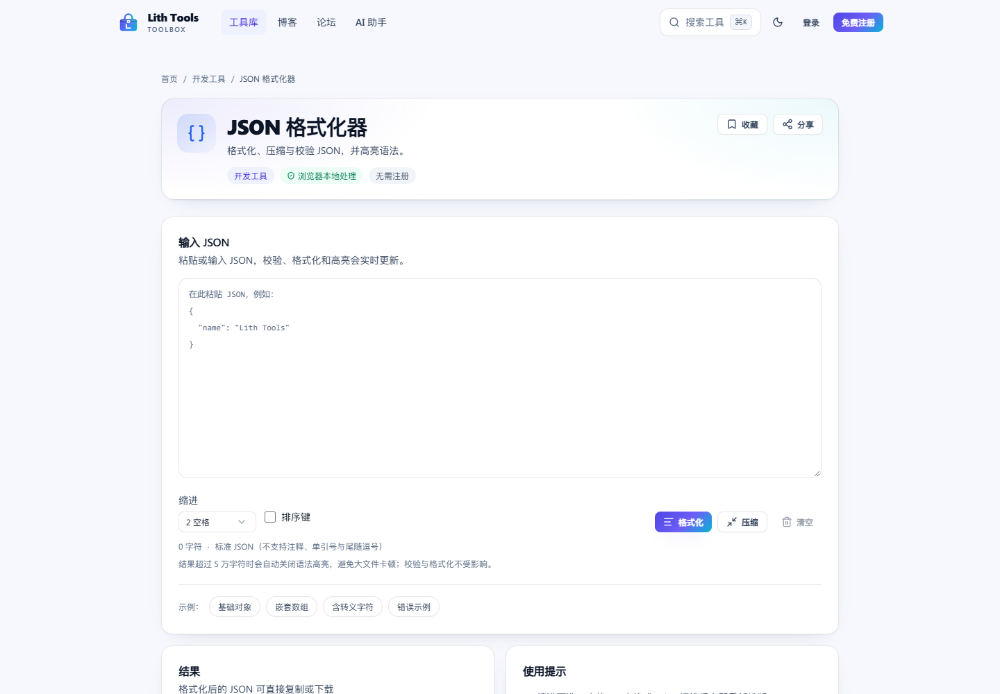
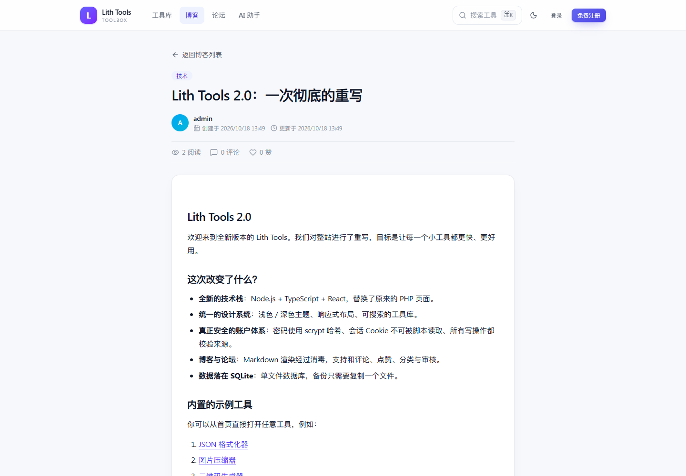
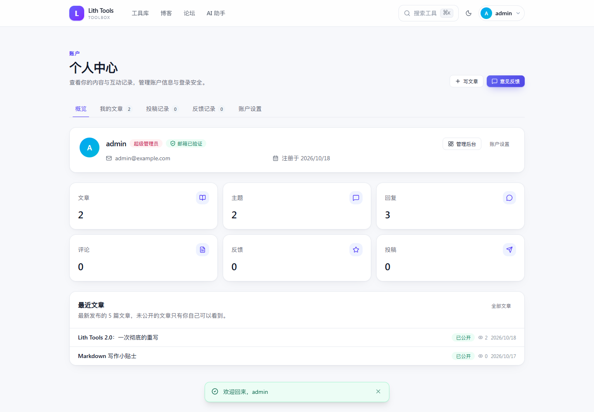
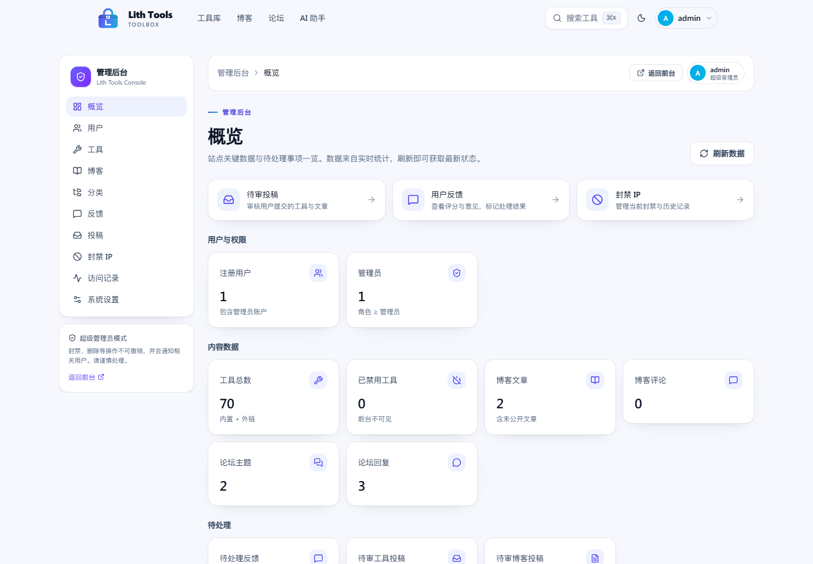
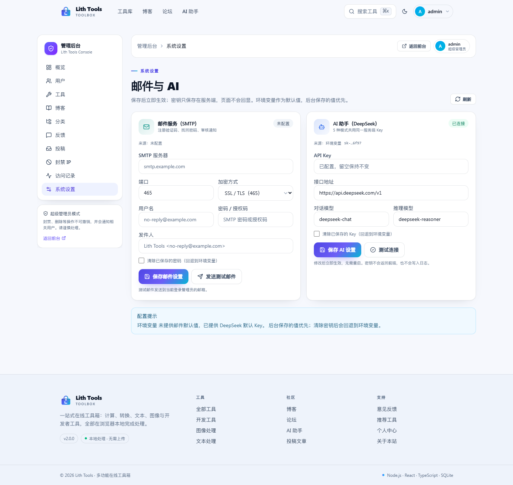
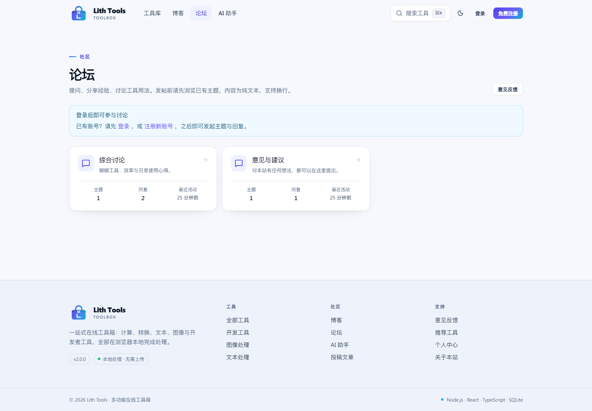
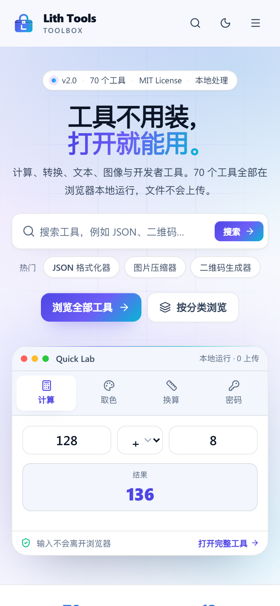

<div align="center">


# Lith Tools

**70 个浏览器端工具 · 博客 · 论坛 · 管理后台 —— 一站式在线工具箱**

把计算、转换、文本、图像与开发者工具放进一个干净、快速、隐私友好的界面。

[](../../actions/workflows/ci.yml)
[](LICENSE)
[](package.json)
[](package.json)
[](tsconfig.json)
[](docs/CONTRIBUTING.md)

[功能](#功能) · [截图](#截图) · [快速开始](#快速开始) · [配置](#配置) · [架构](docs/ARCHITECTURE.md) · [API](docs/API.md) · [部署](docs/DEPLOYMENT.md) · [宝塔/小皮](docs/PANEL.md) · [贡献](docs/CONTRIBUTING.md) · [更新日志](docs/CHANGELOG.md)

</div>


## 简介

Lith Tools 是一个自托管的在线工具箱。它最初是一个个人 PHP 练手项目，2.0 版本用统一的技术栈完成了整体重写：**Node.js + TypeScript + Fastify + SQLite + React**。

设计原则：

- **本地优先**：图片、文件、音频等处理全部在浏览器里完成，不上传服务器。
- **真实能力**：只提供真正能用的功能，不伪造格式转换；界面明确标注限制。
- **开箱即用**：没有 MySQL、PHP、原生编译依赖，`npm install` 后即可运行。
- **可维护**：前后端共享类型契约，工具自动注册，一套设计系统与安全中间件。

## 功能

### 工具（70 个 / 13 个分类）

| 分类 | 数量 | 示例 |
| --- | --- | --- |
| 计算器 | 4 | 标准、科学、投资回报、贷款/抵押 |
| 数学工具 | 8 | 斐波那契、质因数、几何、统计、LaTeX 转图片、GPA、进制转换 |
| 时间工具 | 4 | 世界时钟、倒计时、番茄钟、时间换算 |
| 单位转换 | 5 | 长度、重量、温度、货币（实时汇率）、农历/公历 |
| 文本处理 | 4 | 字数统计、文本对比、AES 加解密、Markdown 编辑器 |
| 颜色工具 | 4 | 图片取色、色码转换、调色板、渐变生成 |
| 开发工具 | 6 | JSON 格式化、正则测试、代码高亮、HTTP 请求、二进制互转 |
| 文件工具 | 4 | ZIP 压缩/解压、批量重命名、在线编辑器 |
| 健康工具 | 4 | BMI、每日热量、心率、BMR |
| 图像处理 | 5 | 缩放、压缩、水印、编辑、标注 |
| 网络工具 | 5 | IP 查询、DNS 查询、TCP 连通性、密码强度/生成 |
| 娱乐工具 | 8 | 二维码、随机数、抽签、大转盘、井字棋、便签 |
| 其它工具 | 9 | 反应测试、CPS、Elo、音频/视频/图片转换、数独、算式生成 |

> 完整的工具清单与旧版路径对照见 [`docs/URL-MAP.md`](docs/URL-MAP.md)。

### 社区与账户

- **博客**：普通用户投稿后人工审核，管理员可直接用 Markdown 写作 / 发布（实时预览、KaTeX 公式、代码块、分类、公开/私密）；支持点赞与分页评论。
- **论坛**：板块、主题、回复、编辑/删除、管理员板块管理。
- **账户**：邮箱验证码注册、登录、找回密码、资料/密码修改、会话管理、个人中心。
- **LCZOJ 授权登录**：登录页可通过 OAuth 2.0 使用 LCZOJ 账号授权登录（首次自动创建本地账号，不共享密码与会话）。
- **反馈与投稿**：评分反馈、工具推荐、审核流转、邮件通知（可选）。

### 管理后台

数据概览、用户管理（角色/封禁/删除）、工具上下架与外链工具、博客与分类管理、反馈处理、工具/博客投稿审核、IP 封禁与历史、访问记录与访问统计，以及 **SMTP 邮件与 DeepSeek AI 的在线配置**（保存即生效，密钥不回显）。

### 可选集成

- **邮件**：配置 SMTP 后发送验证码、重置链接与审核通知。
- **AI 助手**：接入 DeepSeek，支持通用对话、深度思考（展示推理过程）、代码、翻译与写作五种模式；密钥只保存在服务端，可在管理后台填写，环境变量作为默认值。
- **LCZOJ 登录**：通过 OAuth 2.0 授权码流程使用 LCZOJ 账号登录；密码不经过本站，可选启用。LCZOJ 侧配置见其 `docs/OAUTH.md`。

## 截图

| 工具库 | 工具页 |
| --- | --- |
|  |  |

| 博客 | 个人中心 |
| --- | --- |
|  |  |

| 管理后台 | AI 助手 |
| --- | --- |
|  |  |

| 系统设置 | 深色模式 |
| --- | --- |
|  |  |

| 论坛 | 移动端 |
| --- | --- |
|  |  |

## 技术栈

| 层 | 选型 | 说明 |
| --- | --- | --- |
| 运行时 | Node.js ≥ 22.5 | 使用内置 `node:sqlite`，无原生编译依赖 |
| 服务端 | Fastify 5 + TypeScript | 统一错误处理、Cookie、静态资源与 SPA 回退 |
| 数据库 | SQLite（WAL） | 单文件、迁移 + 幂等种子、外键与级联 |
| 前端 | React 19 + React Router 7 | 工具懒加载，首屏轻量 |
| 构建 | Vite 7 + Tailwind CSS v4 | 设计令牌 + 组件类，按工具拆包 |
| 校验 | zod 4 | 所有写接口显式校验 |
| 密码 | `scrypt`（Node crypto） | 随机盐 + `timingSafeEqual` |
| 测试 | Playwright（本机 Chrome）+ Node 脚本 | API 冒烟、70 工具渲染、UI 流程与截图 |
| 传输 | Brotli / gzip + immutable 缓存 | `@fastify/compress`，静态资源按哈希长缓存 |
| AI | DeepSeek（OpenAI 兼容） | 5 种模式，服务端代理，密钥不下发 |

## 快速开始

### 环境要求

- Node.js **22.5+**（推荐 24）
- npm 10+
- 无需 MySQL、PHP 或任何原生模块

### 本地开发

```bash
# GitHub
git clone https://github.com/lichenzhen0713/Lith-tools.git lith-tools
# 或 Gitee 镜像
# git clone https://gitee.com/lichenzhen0713/Lith-tools.git lith-tools
cd lith-tools

npm install
cp .env.example .env      # Windows: copy .env.example .env
npm run db:seed           # 建库 + 70 个工具 + 默认管理员 + 示例内容
npm run dev               # API :8787 · 前端 :5173
```

打开 **<http://localhost:5173>**。

默认超级管理员（仅当数据库中不存在超级管理员时创建）：

```text
用户名：admin
密码：  admin123456
```

> ⚠️ 登录后请立即在「个人中心 → 账户设置」修改密码。
> 未配置 SMTP 时，注册验证码会打印在服务端日志中，并（仅开发模式）随接口返回自动填入。

### 生产构建

```bash
npm run build
NODE_ENV=production node dist-server/server/index.js
```

单进程同时提供 API 与静态资源，默认 <http://127.0.0.1:8787>。生产环境请通过 HTTPS 访问；本地用 HTTP 验证生产构建时设置 `COOKIE_SECURE=false`。

### 一键部署 / 面板部署

Linux（含宝塔 / 小皮 Linux 版）：

```bash
sudo bash deploy/install.sh --origin https://tools.example.com
# 面板只构建、不安装 systemd：
bash deploy/install.sh --no-service
```

Windows（含小皮 Windows 版）：

```bat
deploy\install.bat
```

脚本会安装依赖、构建、生成带随机管理员密码的 `.env`。宝塔 / 小皮的 Node 项目、PM2、反向代理、HTTPS
与排错步骤见 **[docs/PANEL.md](docs/PANEL.md)**；通用部署说明见 [docs/DEPLOYMENT.md](docs/DEPLOYMENT.md)。

### Docker

```bash
docker compose up -d --build
```

数据保存在宿主机 `./data`，通过环境变量覆盖配置（见 `docker-compose.yml`）。

## 配置

复制 `.env.example` 为 `.env`。所有配置均有默认值；邮件与 AI 也可以在 **管理后台 → 系统设置** 中填写，后台值优先于环境变量：

| 变量 | 默认 | 说明 |
| --- | --- | --- |
| `HOST` / `PORT` | `127.0.0.1` / `8787` | 监听地址与端口 |
| `PUBLIC_ORIGIN` | 空 | 对外访问地址，用于邮件链接与来源校验 |
| `TRUST_PROXY` | `false` | 位于 Nginx / Cloudflare 后时设为 `true` |
| `DB_PATH` | `./data/lith-tools.db` | SQLite 路径 |
| `SESSION_TTL_DAYS` | `30` | 登录会话有效期 |
| `COOKIE_SECURE` | 生产默认 `true` | 会话 Cookie 的 `Secure` 标记；本地 HTTP 测试设为 `false` |
| `ADMIN_USERNAME` / `ADMIN_EMAIL` / `ADMIN_PASSWORD` | `admin` / `admin@example.com` / `admin123456` | 首次启动创建超级管理员 |
| `SMTP_HOST` / `SMTP_PORT` / `SMTP_SECURE` / `SMTP_USER` / `SMTP_PASS` / `SMTP_FROM` | 空 / `465` / `true` | 邮件服务 |
| `DEEPSEEK_API_KEY` / `DEEPSEEK_BASE_URL` | 空 / `https://api.deepseek.com/v1` | AI 助手密钥与接口地址（仅服务端） |
| `DEEPSEEK_CHAT_MODEL` / `DEEPSEEK_REASONING_MODEL` | `deepseek-chat` / `deepseek-reasoner` | 对话与深度思考模型 |
| `LCZOJ_BASE_URL` | 空 | LCZOJ 站点地址（如 `https://oj.example.com`）；留空则关闭授权登录 |
| `LCZOJ_CLIENT_ID` / `LCZOJ_CLIENT_SECRET` | 空 | 与 LCZOJ 的 `OJ_OAUTH_CLIENT_ID` / `OJ_OAUTH_CLIENT_SECRET` 保持一致 |
| `LCZOJ_REDIRECT_URI` | 空 | 回调地址；留空时按请求 Host 推导为 `<origin>/api/auth/lczoj/callback` |
| `LCZOJ_NAME` | `LCZOJ` | 登录按钮与授权提示里的站点名称 |
| `SEED_DEMO` | `true` | 空库时写入欢迎博客/论坛内容 |

## 脚本

| 命令 | 作用 |
| --- | --- |
| `npm run dev` | 并行启动 API（tsx watch）与 Vite 前端 |
| `npm run dev:api` / `npm run dev:web` | 只启动其中一个 |
| `npm run build` | 服务端类型检查 + Vite 生产构建 |
| `npm start` | 运行构建产物（需先 `npm run build`） |
| `npm run typecheck` | 前后端 strict TypeScript 检查 |
| `npm run db:seed` | 建表 + 幂等写入工具目录/分类/管理员/示例内容 |
| `npm run db:reset` | 删除并重建数据库（仅限 `data/` 内文件） |
| `npm run smoke` | 端到端 API 冒烟测试（需运行中的服务） |
| `npm run tools:check` | 用本机 Chrome 遍历 70 个工具页并截图 |
| `npm run ui:check` | 浏览器 UI 冒烟测试（首页/搜索/暗色/博客/论坛/登录/后台/移动端） |
| `npm run verify:extras` | 校验 AI 五种模式、KaTeX 渲染与字体加载 |
| `npm run snapshot` | 生成完整页面截图（视觉回归用） |
| `npm run docs:map` | 重新生成 `docs/URL-MAP.md` |
| `bash deploy/install.sh` | Linux 一键部署（安装 Node、构建、生成 `.env`、systemd） |
| `deploy\install.bat` | Windows 一键部署（构建、生成 `.env`、启动） |
| `pm2 start deploy/ecosystem.config.cjs` | 用 PM2 守护运行 |

## 测试与质量

本项目在 Node 24 + Chrome（playwright-core）环境完成了以下检查，全部通过：

| 检查 | 结果 |
| --- | --- |
| `npm run typecheck`（前端 + 服务端，strict） | 0 错误 |
| `npm run build`（tsc + Vite） | 成功，按工具拆分为独立 chunk |
| `npm run smoke` | 注册/登录/博客/评论/点赞/论坛/反馈/投稿/权限/管理后台全部通过 |
| `npm run tools:check` | **70/70** 工具页渲染无错误 |
| `npm run ui:check` | 首页、搜索面板、暗色模式、工具库、工具页、博客、论坛、登录、个人中心、管理后台、移动端全部通过 |
| `npm run verify:extras` | AI 5 种模式、DeepSeek 对话/推理、KaTeX 与字体加载全部通过 |
| 生产静态服务 | `/`、`/assets/*`、`/tools/<slug>` SPA 回退、`/api/*` 均正确响应 |

浏览器检查依赖本机安装的 Chrome，截图写入 `screenshots/`（已 gitignore）。

### 性能与体积

- 首屏（应用外壳 + 首页 + 图标/目录 chunk）约 **462 KB 原始 / 114 KB Brotli**（含 React vendor 与 CSS）。
- 应用入口 JS 从 **326 KB 拆分**为 44 KB 应用代码 + 255 KB 可长期缓存的 React vendor。
- 移除 `jsPDF`（运行时 chunk −376 KB、安装体积 −28.7 MB），PDF 导出改用浏览器原生打印。
- KaTeX 从 Markdown 默认依赖中移出，仅在有公式时按需加载；构建时裁剪 ttf/woff 旧字体（**−0.78 MB**）。
- `html2canvas`、`JSZip`、二维码等仅在对应工具中懒加载。
- 全站 Brotli/gzip 压缩；带哈希的静态资源使用一年 `immutable` 缓存，`index.html` 保持 `no-cache`。
- `dist/` 总体积约 **2.3 MB**（仍包含全部工具与 woff2 字体）。

## 目录结构

```text
lith-tools/
├─ shared/                 # 前后端共享：工具目录、API 类型
│  ├─ catalog.ts           # 70 个工具的元数据（分类、图标、关键词）
│  └─ types.ts             # DTO 契约
├─ server/
│  ├─ index.ts             # 启动入口（迁移 → 种子 → 监听 → 定时维护）
│  ├─ app.ts               # Fastify 组装、安全钩子、静态资源与 SPA 回退
│  ├─ config.ts            # 环境变量
│  ├─ db/                  # SQLite 客户端、迁移、种子
│  ├─ lib/                 # 认证、密码、限流、邮件、封禁/访问统计、校验
│  ├─ routes/              # auth / public / blog / forum / engagement / admin / network / assistant
│  └─ scripts/             # seed、reset
├─ src/
│  ├─ components/          # 布局、搜索面板、UI 组件库、Markdown 渲染
│  ├─ lib/                 # api、auth、theme、toast、hooks
│  ├─ pages/               # 首页、工具库、博客、论坛、账户、管理后台
│  ├─ tools/               # 每个工具一个懒加载组件 + kit
│  └─ styles/index.css     # Tailwind v4 设计令牌与组件类
├─ scripts/                # smoke / tools-check / ui-check / 文档生成
├─ deploy/                 # 一键安装、面板启动、systemd / PM2 / Nginx 模板
├─ docs/                   # 架构、API、部署、面板、迁移、URL 对照、截图
├─ .github/                # CI、Issue/PR 模板、Dependabot
├─ Dockerfile / docker-compose.yml
└─ data/lith-tools.db      # SQLite（首次运行生成，已 gitignore）
```

## 架构

```text
浏览器（React SPA）
   │  fetch /api/*（HttpOnly 会话 Cookie）
   ▼
Fastify
   ├─ onRequest：安全响应头 → Origin 校验 → IP 封禁 → 访问计数
   ├─ 路由：zod 校验 → 业务逻辑 → SQLite（参数化查询）
   ├─ 静态：dist/ + SPA 回退（非 /api 路径返回 index.html）
   └─ 定时任务：清理过期会话、归档过期封禁（每 10 分钟）
```

- 工具由 `src/tools/<slug>.tsx` 自动发现、按需加载；元数据集中在 `shared/catalog.ts`。
- 权限模型：`0` 普通用户、`1` 管理员、`2` 超级管理员；写操作都做资源级校验。
- 会话：随机 256-bit ID 存 SQLite，Cookie 为 `HttpOnly + SameSite=Lax`（生产 `Secure`）；封禁账户立即失效。
- 访问统计沿用旧版两级计数（临时表 → 主表），仅统计文档导航。

更完整的设计说明见 [`docs/ARCHITECTURE.md`](docs/ARCHITECTURE.md)。

## API

所有接口以 `/api` 开头，JSON 通信；失败返回 `{ "error": "..." }`。完整参考：[`docs/API.md`](docs/API.md)。

| 模块 | 代表接口 |
| --- | --- |
| 站点 | `GET /api/tools`、`GET /api/tools/:slug`、`GET /api/stats/public` |
| 认证 | `POST /api/auth/register`、`/login`、`/forgot`、`/reset`；`GET /auth/me` |
| 博客 | `GET /api/blog/posts`、`POST /api/blog/posts/:id/like`、`POST /api/blog/posts/:id/comments` |
| 论坛 | `GET /api/forum/forums`、`POST /api/forum/forums/:id/threads`、`POST /threads/:id/posts` |
| 管理 | `/api/admin/users`、`/admin/tools`、`/admin/submissions`、`/admin/bans` |
| 网络 | `GET /api/net/ip`、`/net/dns`、`/net/rates`；`POST /net/ping` |
| AI | `GET /api/assistant/status`；`POST /api/assistant/chat`（5 种模式，登录 + 限流） |
| 系统设置 | `GET /api/admin/settings`；`PUT /api/admin/settings/mail`、`/settings/ai`；`POST /settings/test-mail`、`/settings/test-ai`（超级管理员） |

## 安全

- scrypt 密码哈希；会话 Cookie `HttpOnly`/`SameSite=Lax`（生产 `Secure`）。
- 非 GET 请求校验 `Origin` 与 Host 一致（同源 JSON API，无需可读 CSRF token）。
- 登录、注册、验证码、找回密码、发帖、评论、投稿、AI 对话分别限流。
- 所有写接口 zod 校验；SQL 全部参数化。
- Markdown 经 `DOMPurify` 消毒；用户输入由 React 转义。
- 网络工具限制端口并拒绝内网地址；IP/汇率查询由服务端缓存代理。
- AI 密钥只存在服务端环境变量。

安全模型、部署加固与漏洞报告方式见 [`SECURITY.md`](docs/SECURITY.md)。

## 与旧版的关系

旧版 PHP 站点（未包含在本仓库）是本项目的前身，本仓库是独立重写。产品概念、角色模型与中文文案尽量保留；同时修复了旧版的 SQL 注入、存储型 XSS、缺失 CSRF/限流、明文密钥、越权编辑/审核等问题。

- 旧版 → 新版 URL 对照：[`docs/URL-MAP.md`](docs/URL-MAP.md)
- 迁移说明与有意变更：[`docs/MIGRATION.md`](docs/MIGRATION.md)
- 旧版差异摘要：假格式转换改为真实能力、DES 改为 AES-GCM、审核/反馈保留状态、封禁即时生效、AI 密钥移出浏览器。

## 路线图

- [x] 70 个工具、博客、论坛、反馈、投稿、管理后台
- [x] 邮箱验证、找回密码、会话管理
- [x] IP 封禁、访问统计、审核流转
- [x] Docker / CI / Issue 模板 / 安全策略
- [ ] 工具使用量统计与热门排序
- [ ] 博客全文搜索（FTS5）
- [ ] 多语言界面（i18n）
- [ ] WebSocket 实时通知
- [ ] 对象存储 / 附件上传（可选）

## 贡献

欢迎提交 Issue 与 Pull Request。开始之前请阅读：

- [`CONTRIBUTING.md`](docs/CONTRIBUTING.md)：开发环境、代码风格、如何新增工具
- [`TOOLS_GUIDE.md`](docs/TOOLS_GUIDE.md)：工具实现约定
- [`CODE_OF_CONDUCT.md`](docs/CODE_OF_CONDUCT.md)：社区行为准则

## 许可证

[MIT](LICENSE) © Lith Tools contributors

## 致谢

- 旧版 PHP 站点与其作者，为项目提供了最初的产品形态与工具清单。
- [Fastify](https://fastify.dev/)、[React](https://react.dev/)、[Vite](https://vite.dev/)、[Tailwind CSS](https://tailwindcss.com/)、[lucide](https://lucide.dev/) 等开源项目。
- 所有为工具清单、测试与文档做出贡献的人。
